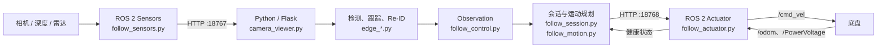

# Wheeltec C30D 人物跟随

基于 Raspberry Pi 5、YOLO11n、二维激光雷达和 OSNet Re-ID 的室内跟随小车。支持指定人物跟随和不认主跟随。当前版本为 **2.0.1**，实车验收仍在进行中。

## 系统概览

ROS 2 负责传感器和底盘接口；Python/Flask 应用完成检测、跟踪、会话状态与速度规划。当前桥接与安全逻辑已迁入 `follow_bridges` 包，组合启动由 `follow_bringup` 管理；两个本机 HTTP 桥接端口连接应用和 ROS 2 节点。



## 目录地图

```text
.
├── src/                  Python 应用：网页、感知、会话、运动、安全与资源路径
├── web/templates/        Flask 控制页面
├── ros2_ws/src/          活动 ROS 2 节点、bringup 与轻量差速仿真包
├── reference/ros2_ws/    ROS 2 架构参考骨架，不参与当前构建
├── sim/                  MuJoCo 场景、演示脚本和批量跟随实验
├── config/               运行参数、几何标定和跟踪器配置
├── models/               推理权重、模型元数据及许可证
├── ops/                  发布、部署、连接、诊断和现场记录脚本
├── requirements/         开发、车端、桌面、导出和仿真依赖
├── tests/                自动化测试
├── validation/           实车验收摘要与遥测记录
├── docs/                 架构、开发、部署、研究和调参文档
│   └── html/             交互式硬件页与架构导览
├── assets/samples/       开发样本
├── output/pdf/           项目说明 PDF
├── releases/             发布归档输出目录
├── tools/legacy/         历史工具，不是当前运行入口
└── .github/              CI、Issue 与 Pull Request 模板
```

`src/` 保持应用模块平铺；`src/follow_bridges/` 是供旧发布布局使用的 ROS 节点实现副本，活动 ROS 包位于 `ros2_ws/src/follow_bridges/`。`ros2_ws/build/`、`install/` 和 `log/` 是本地产物，不属于源代码。

## 开发命令

```console
python -m venv .venv
python -m pip install -r requirements/dev.txt
python -m pytest -q -p no:cacheprovider
python ops/build_release.py
```

测试使用传感器数据和 ROS 替身，不会驱动小车。构建产物写入 `releases/`。本地运行网页需要配置相机、ROS 2 桥和推理后端；连接现有小车的 Windows 入口见 [部署指南](docs/deployment.md)。实车试跑脚本会发送运动指令，操作条件见部署文档。

## 文档入口

按“项目概览、开发、运行、验证、学习”浏览[文档索引](docs/README.md)。常用入口：[架构](docs/architecture.md) · [开发](docs/development.md) · [ROS 2 包化运行](docs/ros2-packages.md) · [部署](docs/deployment.md) · [调参](docs/tuning-guide.md) · [实车记录](docs/IMPLEMENTATION.md) · [仿真实验](docs/sim-experiments.md) · [项目 HTML 页](docs/html/说明.md) · [小车说明书 PDF](output/pdf/Wheeltec-C30D-小车说明书与项目工作汇报.pdf)。

凭据、SSH 私钥、运行缓存和原始日志不应提交。贡献流程见 [CONTRIBUTING.md](CONTRIBUTING.md)；仓库规范见 [AGENTS.md](AGENTS.md)。
