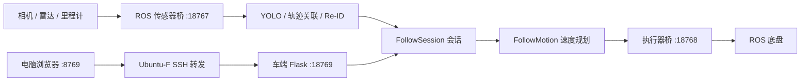

# 架构与目录约定

## 模块职责

| 目录 / 模块 | 职责 |
| --- | --- |
| `src/camera_viewer.py` | HTTP 页面和接口、感知与控制循环协调 |
| `src/follow_session.py` | 人物选择、确认、等待、恢复、停止和会话标识 |
| `src/follow_motion.py` | 车头净距、障碍等待、速度上限和加速度限制 |
| `src/follow_control.py` | 传感器数据结构、人物测距关联和共享控制计算 |
| `src/edge_*.py` | YOLO ONNX 推理、两阶段轨迹关联和 OSNet Re-ID |
| `src/follow_sensors.py` | ROS 相机、雷达、TF 数据读取及 HTTP 输出 |
| `src/follow_actuator.py` | 下发速度、指令看门狗、电量保护和里程计读取 |
| `src/follow_settings.py` | 配置加载及范围校验 |
| `src/runtime_paths.py` | 源码目录与车端发布目录的资源定位 |
| `web/templates/` | Flask 网页模板 |
| `ops/` | 运维与发布，不承载跟随决策 |

## 控制边界

会话状态由车端控制循环更新；网页读取状态不推动跟随决策。关闭页面不取消已启动会话。控制服务启动后进入待机；旧启动请求不能在人工停止后恢复运动。预测框只用于关联，运动需要新的可信观测。

执行器独立执行指令过期停车、电压保护和停止检查。网页所示计划速度、实际下发速度和里程计反馈应分别读取，不能互相替代。

## 仓库与发布目录

源码按职责分目录，发布包沿用已安装小车的平铺模块结构：

| 仓库路径 | 发布包 / 车端路径 |
| --- | --- |
| `src/*.py` | `*.py` |
| `config/follow_settings.json` | `follow_settings.json` |
| `config/calibration.json` | `calibration.json` |
| `config/botsort_reid.yaml` | `botsort_reid.yaml` |
| `web/templates/follow.html` | `templates/follow.html` |
| `models/osnet_*`、相关许可证 | `models/` 中对应文件 |
| 选定的 `ops/` 文件 | `ops/` 中对应文件 |

完整白名单在 `ops/build_release.py`。`runtime_paths.py` 同时随 ROS 桥复制到容器，避免配置模块缺少依赖。不要把整个源码仓库直接覆盖到运行目录。
