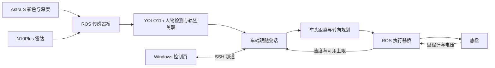

# Wheeltec C30D 小车说明书

适用版本 **2.0.1** · 车端信息核对于 **2026-11-16**

[GitHub 项目](https://github.com/ltwxxx/wheeltec-c30d-yolo-follow) · [本机控制页](http://127.0.0.1:8769/) · [调参指南](tuning-guide.md)

本车用于室内平地的人物跟随，支持指定人物跟随和不认主跟随。树莓派负责识别、测距、跟踪和底盘控制。电脑负责显示画面、启动和停止会话，也用于调参、构建和部署。小车开机进入待机，已启动的会话由车端持续处理。

## 1. 快速使用

1. 打开整车电源，等树莓派启动。让电脑与小车连接 `ltw`，打开[本机控制页](http://127.0.0.1:8769/)。
2. 确认实时画面、人物识别、雷达和底盘状态已更新。选中人物编号后点击「启动普通跟随」，或点击「启动不认主跟随」让车选择目标。
3. 初次试跑可勾选「车端试跑（最多 10 秒）」，再点击「启动车端试跑」。这是普通跟随的限时模式，前进指令最高 0.07 m/s，转向指令最高 0.12 rad/s，到时由车端停止。
4. 点击「停止跟随」或「停止不认主跟随」结束会话。关闭浏览器或电脑掉线后，车端会话仍然有效。重新打开页面可查看和停止。
5. 需要结束使用时，点击「关闭车载主机」并确认。系统会先停止会话并核对零速度和新鲜里程计反馈，然后关机。整车电池总开关需要手动关闭。

车端快照显示 **2.0.1、待机、相机和雷达在线、底盘就绪**。采样时底盘电压为 **11.23 V**，网页显示**估算 35%**。0.25 m/s 巡航档已部署，实际全速、制动距离和 30 cm 停车精度仍待现场验收。

## 2. 硬件和运行环境

| 部件 | 本车信息 |
| --- | --- |
| 整车与底盘 | Wheeltec C30D，原厂 ROS 模型 `mini_mec`。雷达、相机和车头保持原厂安装位置 |
| 车载主机 | Raspberry Pi 5 Model B Rev 1.1，4 GB 档，`aarch64`。系统报告可见内存为 4,142,224 KiB |
| 车端操作系统 | Debian GNU/Linux 12（bookworm）。根分区为 `/dev/mmcblk0p2`，文件系统为 ext4，所在存储设备容量约 59.5 GiB |
| 彩色／深度相机 | Orbbec Astra S，USB ID `2bc5:0402`，ROS 驱动 `astra_camera`，当前彩色和深度模式均为 320×240 @ 30 Hz |
| 雷达 | N10Plus 二维激光雷达，ROS 驱动 `lslidar_driver`，容器串口 `/dev/wheeltec_lidar` |
| 底盘通信 | ROS 驱动 `turn_on_wheeltec_robot`，容器串口 `/dev/wheeltec_controller`，上报里程计和供电电压 |
| 供电 | 使用现有车载电池。精确容量、化学类型、充电器输出规格和电压采样误差尚待核对 |
| ROS 环境 | ROS 2 Humble，Docker 容器 `codex-camera-live`，镜像 `ros2:wheeltec_V1.1`，容器内 Ubuntu 22.04.4 LTS |
| 车端应用 | Python 3.11.2、Flask 2.2.2、ONNX Runtime 1.23.2、NumPy 1.24.2、SciPy 1.10.1、Pillow 9.4.0。版本来自车端实施记录 |
| 控制电脑 | Windows，WSL 发行版 `Ubuntu-F`，以 SSH 隧道连接车上的网页服务 |

当前跟随控制向底盘下发前进速度 `linear.x` 和转向角速度 `angular.z`，根据人物相对车头的方向和净距计算跟随。人物偏侧较大时先转向对准。固定航点巡航和绕障路径规划尚未实现。

## 3. 联网、SSH 和控制页

| 项目 | 地址或名称 |
| --- | --- |
| 当前 Wi-Fi | `ltw` |
| 小车主机名 | `wheeltec`，局域网发现名称 `wheeltec.local` |
| 最近核对的车端地址 | `192.168.179.2/24`，可能随热点和 DHCP 租约变化 |
| 车端 SSH | 用户 `wheeltec`，端口 22。已保存原主机密钥的控制电脑可运行 `ssh -o HostKeyAlias=192.168.1.242 wheeltec@wheeltec.local` |
| 电脑本机网页 | [http://127.0.0.1:8769/](http://127.0.0.1:8769/) |
| 车端本机网页 | `http://127.0.0.1:18769/` |
| 车端传感器桥 | `http://127.0.0.1:18767/` |
| 车端执行器桥 | `http://127.0.0.1:18768/` |

电脑上的计划任务 `Wheeltec Follow Console` 在 Windows 登录后等待小车上线。连接脚本会尝试上次成功的 IP、`wheeltec.local` 解析到的地址和原地址 `192.168.1.242`，始终校验已知的 SSH 主机密钥。相机、深度、雷达和底盘就绪后，控制页自动打开。电脑端如果没有转发进程，可在项目根目录的 PowerShell 运行以下命令。

```powershell
& .\ops\start-follow-console.ps1
```

小车已保存 `ltw` 的开放网络配置和加密配置。Windows 也已保存同一 SSID 的 WPA2、WPA3 个人加密自动连接配置。热点保持同名并使用已保存的密码时，两端会尝试连接。热点改为加密后的重连尚未实测。Wi-Fi 密码、SSH 密码和私钥由各设备保管。

`127.0.0.1` 指访问网页的设备自身，手机打开该地址会访问手机自身。目前控制台通过电脑本机隧道使用，手机和其他电脑的局域网入口待配置。Windows 上出现 `CH9102` 或 `COM15` 时，曾确认它是底盘串口。有线网络登录需要连接树莓派的 RJ45 网口，确保链路接通并取得局域网地址。

## 4. 软件工作流程



- **检测**采用 ONNX Runtime 的 CPU 后端。车端 YOLO11n 模型为 `follow-yolo11n.onnx`，输入 320×320，识别 COCO 的人物类别。彩色图像缩放补边后进入模型，控制使用最新可用画面。
- **跟踪**采用 ByteTrack 思路的高低分两阶段关联，并用卡尔曼预测和衣服颜色辅助匹配。低分框可以延续已有轨迹，新人物需要高分观测确认。预测框用于关联，车端运动需要当前观测。
- **Re-ID** 在普通模式用来恢复已有的指定人物身份。模型为 `OSNet-x0.25`，使用 Market1501 权重，输入裁剪为 256×128（高×宽），输出 512 维特征。后台线程使用有界队列，正常最多每秒两批，每批最多两个人。身份不确定时先停车等待。
- **普通跟随**可以从列表选人物编号，也可以让车自动选择第一个目标并保持其身份。短时漏检或遮挡时小车停车等待，原目标重新确认后恢复。
- **不认主跟随**尽量延续当前人物。丢失后停车并保留约 0.50 秒恢复窗口，随后优先选择更接近画面中央的人。换人需要新画面确认。
- **状态**包括待机、确认目标、跟随中、到达距离、等待人物、等待通道、故障暂停和人工停止。网页读取状态，小车自己处理状态转换。车端控制服务重新启动后进入待机。

模型训练来源、许可证与 SHA-256 见 [OSNet 元数据](../models/osnet_x0_25.json)和 [OSNet 许可证](../models/OSNET-LICENSE)。车端 YOLO ONNX 由现有安装提供，仓库中的 `models/wheeltec-yolo11n.pt` 用于可选的桌面推理和开发。

## 5. 雷达、点云和距离基准

| ROS 话题 | 类型 | 用途 |
| --- | --- | --- |
| `/scan` | `sensor_msgs/msg/LaserScan` | 跟随测距和前方障碍判断，包含角度、距离范围及各束的 `ranges` |
| `/x10/lslidar_point_cloud` | `sensor_msgs/msg/PointCloud2` | 雷达平面点云，可在 RViz 查看或用于二维地图工作流 |
| `/camera/color/image_raw` | `sensor_msgs/msg/Image` | 彩色人物识别 |
| `/camera/depth/image_raw` | `sensor_msgs/msg/Image` | 对齐深度，辅助检查前方近障 |
| `/camera/color/camera_info` | `sensor_msgs/msg/CameraInfo` | 相机内参和投影 |
| `/tf`、`/tf_static` | `tf2_msgs/msg/TFMessage` | 雷达、相机和底盘坐标转换 |
| `/cmd_vel` | `geometry_msgs/msg/Twist` | 底盘前进与转向指令 |
| `/odom` | `nav_msgs/msg/Odometry` | 回传底盘速度和位姿，用于状态显示、制动估算和停止核对 |
| `/PowerVoltage` | `std_msgs/msg/Float32` | 底盘供电电压，单位 V |

2026-11-16 的只读采样中，`/scan` 坐标系为 `laser`，约 **9.9 Hz**，每帧 **540 束**，角度步进约 **0.667°**。消息声明范围为 0.15～50.0 m，实际有效探测距离要按目标反射和现场环境实测。同次采样收到 **8 帧雷达点云**，最后一帧为 `laser` 坐标系下的 525×1 点云，来自单平面扫描。相机驱动的深度点云计算在当前跟随启动配置中关闭。

车端将雷达回波转换到相机坐标，按相邻角度和位置聚类，再与人物框关联。根据可信的目标回波得到车头净距。前方障碍使用车宽与余量覆盖的通道，结合新鲜扫描判定。失去可信人物测距时，远处可低速依靠画面辅助，接近时等待可信测量。

| 原厂模型几何 | 数值 |
| --- | --- |
| 底盘坐标系中车头最前端 | 0.13149 m |
| 雷达参考位置 | 0.03163 m |
| 相机参考位置 | 0.10709 m |
| 雷达中心到车头 | 0.09986 m，约 9.99 cm |
| 相机参考位置到车头 | 0.02440 m，约 2.44 cm |
| 车身半宽 / 通道单侧余量 | 0.116 m / 0.04 m |

沿车头正前方，`车头净距 ≈ 雷达回波距离 − 0.09986 m`。雷达对正前方目标报 0.40 m 时，按原厂几何折算车头净距约 0.30 m。实际跟随用 TF 和回波关联计算。2.44 cm 是原厂模型中的相机参考位置偏移，镜头前表面到车头的实物尺寸仍待测量。[几何标定配置](../config/calibration.json)

## 6. 速度、停车与供电保护

| 触发条件 | 当前策略 |
| --- | --- |
| 普通跟随，制动尚未实测 | 前进指令最高 0.10 m/s |
| 不认主直线巡航 | 人物在车头正前方约 ±5°、相机观测不超过 0.30 s、雷达新鲜且当前观测直接关联到人物回波。巡航净距取目标净距与通道最近回波距离的较小值 |
| 满足上述条件，巡航净距至少 1.25 m | 巡航可用上限 0.25 m/s，实际下发受加速度、电量和当前观测影响 |
| 巡航净距 1.00～1.25 m | 车端将可用上限从 0.10 m/s 逐步提高至 0.25 m/s |
| 退出巡航或暂缺可信测距 | 前进上限回落到 0.10 m/s。近处无可靠测距时停车等待 |
| 目标车头净距小于 0.60 m | 可靠测距下最高 0.05 m/s |
| 到达 / 重新靠近 | 车头净距目标 0.30 m。制动余量会提前下发停车，拉开到 0.40 m 才允许重新靠近 |
| 障碍进入通道 | 按速度和制动余量停止。极近障碍立即停车，普通单点回波需持续确认。通道连续清空 0.50 s 后可恢复 |
| 人物或有效传感器数据丢失 | 目标丢失时停车等待，相机或雷达过期时暂停，观测恢复后重新确认 |
| 指令中断 | 执行器有 280 ms 指令看门狗，每 50 ms 进行 ROS 定时输出。人工停止会同步发布零速度 |
| 低电压 | 低于 10.8 V 限速至 0.10 m/s。低于 10.5 V 持续 3 s 锁定停车。恢复至 10.8 V 并保持 5 s 后可人工重新启动 |

制动估算依据当前下发速度、有效里程计反馈和感知延迟。配置暂以 0.30 m/s² 作为估算减速度，`braking_verified=false`，等待实测。0.25 m/s 是应用和底盘接口的**指令上限**，实际车速以里程计和距离／时间实测为准。

网页电量由底盘上报电压换算，当前估算区间 10.5～12.6 V。电压先经过约 1 秒窗口的中值滤波，数据过期会限制运动。百分比适合观察趋势。精确剩余容量、满电判断与持续蜂鸣原因需核对原装充电器、电池和声源。

## 7. 可调参数

编辑 [follow_settings.json](../config/follow_settings.json) 后运行测试并重新部署。下表为本车当前生效值，包括 JSON 覆盖和 Python 默认值。[参数定义与范围校验](../src/follow_settings.py)

| 配置项 | 当前值 | 作用 |
| --- | --- | --- |
| `max_speed_mps` | 0.25 | 全局前进速度上限 |
| `unlocked_cruise_mps` | 0.25 | 不认主远距巡航上限，设为 0 可关闭此档 |
| `unlocked_clearance_m` | 1.00 | 高于此净距开始提升巡航上限，再增加 0.25 m 达到最高档 |
| `fallback_speed_mps` | 0.10 | 低速跟随上限 |
| `approach_speed_mps` / `near_slowdown_m` | 0.05 / 0.60 | 近距速度与起始距离 |
| `stop_m` / `resume_m` | 0.30 / 0.40 | 停车与恢复净距 |
| `forward_gain_per_s` | 0.65 | 距离误差转为前进速度的比例 |
| `acceleration_mps2` | 0.30 | 前进指令爬升速度 |
| `turn_gain_per_s` / `turn_deadband_deg` | 0.90 / 5° | 人物偏角转成角速度的比例与转向死区 |
| `full_forward_angle_deg` / `turn_only_angle_deg` | 9° / 12° | 从允许全比例前进到只转向的过渡区间 |
| `max_turn_rad_s` / `angular_acceleration_rad_s2` | 0.25 / 0.60 | 最大转向角速度与转向变化率 |
| `obstacle_clear_s` / `target_grace_s` | 0.50 / 0.50 | 障碍清空确认时长与不认主换人等待时长 |
| `detection_min_confidence` / `tracking_new_confidence` | 0.10 / 0.35 | 最低检测分与创建新轨迹所需分数 |
| `detection_nms_iou` | 0.70 | 重叠候选框的抑制阈值 |
| `reid_min_similarity` / `reid_min_margin` | 0.82 / 0.08 | 普通模式身份恢复分数与候选差距 |
| `reid_model` | `models/osnet_x0_25.onnx` | Re-ID 模型路径 |
| `body_half_width_m` / `corridor_margin_m` | 0.116 / 0.04 | 车辆通道宽度按两侧覆盖 |
| `camera_to_front_m` / `geometry_verified` | 0.0244 / `true` | 当前允许使用原厂安装几何 |
| `brake_deceleration_mps2` / `braking_verified` | 0.30 / `false` | 临时制动估计与实测完成标记 |
| `battery_slow_v` / `battery_stop_v` | 10.8 / 10.5 | 限速与停车电压 |
| `battery_stop_s` / `battery_recover_s` | 3 / 5 | 低压持续判定和回升观察时长 |

如果车身左右摆动，先小幅提高 `turn_deadband_deg` 或降低 `turn_gain_per_s`。如果画面中人物框本身频繁消失，先核对照明、遮挡、置信度和轨迹编号。每次改一组参数，用相同路线和光线复测。在网页对比「计划速度 → 下发速度 → 里程计速度」，并查看限速原因。[调参示例和复测顺序](tuning-guide.md)

## 8. 工程、服务和 HTTP 接口

| 文件或服务 | 职责 |
| --- | --- |
| [camera_viewer.py](../src/camera_viewer.py) / [follow.html](../web/templates/follow.html) | Web 服务、画面、检测开关、会话控制和状态面板 |
| [follow_session.py](../src/follow_session.py) / [follow_motion.py](../src/follow_motion.py) | 跟随状态、选人、速度和停车规划 |
| [follow_sensors.py](../src/follow_sensors.py) / [lidar_geometry.py](../src/lidar_geometry.py) | 相机、雷达、TF 和回波聚类 |
| [edge_detector.py](../src/edge_detector.py) / [edge_tracking.py](../src/edge_tracking.py) / [edge_reid.py](../src/edge_reid.py) | YOLO 检测、轨迹关联、身份特征 |
| [follow_actuator.py](../src/follow_actuator.py) / [battery_state.py](../src/battery_state.py) | 速度下发、看门狗、里程计、电压与保护 |
| `wheeltec-follow-edge.service` | 车端用户服务，启动网页、推理和控制循环 |
| `wheeltec-follow-boot.service` | 车端系统服务，启动 ROS 容器、驱动和桥，检查数据新鲜度并在失败后退避重启 |
| [watch-robot-ui.sh](../ops/watch-robot-ui.sh) | Windows/WSL 侧 SSH 转发与自动重连 |
| [build_release.py](../ops/build_release.py) / [deploy-on-robot.sh](../ops/deploy-on-robot.sh) | 可重复构建、SHA-256、安装和失败回退 |

| 服务 | 常用路径 |
| --- | --- |
| 网页（电脑 8769、车端 18769） | `GET /` 页面，`GET /status` 详细状态，`GET /healthz` 就绪信息，`GET /video` 和 `GET /preview.jpg` 画面 |
| 网页操作（同源请求） | `POST /detection` 开关检测，`POST /follow` 启停，`POST /shutdown` 确认后关闭车载主机，`POST /heartbeat` 兼容旧页面 |
| 传感器（车端 18767） | `GET /frame` 最新图像和关联传感器，`GET /scan` 雷达状态，`GET /health` 数据年龄 |
| 执行器（车端 18768） | `GET /health` 读取执行器、底盘和电量，`POST /arm`、`/command`、`/stop` 供车端控制程序使用 |

车端服务只使用本机回环接口，控制页校验 Host 和 Origin。启动跟随请求包含当前车端启动快照、页面标识与请求序号。停止会使旧的启动请求失效。日常操作走网页，排障可通过 GET 读取状态。

## 9. 部署、备份和故障排查

本地开发使用 Python 3.11 或 3.12。修改配置后在项目根目录执行以下命令。

```powershell
python -m pip install -r requirements/dev.txt
python -B -m pytest -q -p no:cacheprovider
python ops/build_release.py
```

构建生成 `releases/wheeltec-2.0.1.tar.gz`。将包上传至车端的用户目录，在网页停止跟随，再从归档解出安装脚本运行。

```bash
archive="$HOME/wheeltec-2.0.1.tar.gz"
stage=$(mktemp -d)
tar -xzf "$archive" -C "$stage" ops/deploy-on-robot.sh
bash "$stage/ops/deploy-on-robot.sh" "$archive"
```

部署适用于已经装好 Docker、ROS 驱动和推理模型的车端。部署器检查停止状态，验证归档并备份现有运行文件，再统一重启 ROS 容器和车端网页，检查相机、雷达、底盘以及待机状态。首次升级 2.0.1 时底盘桥在局部重启后未收到数据，改为一起重启 ROS 容器后验证通过。失败时部署器会尝试还原上个版本。

- 主机应用目录为 `/home/wheeltec/.local/share/wheeltec-follow-edge/`，包含当前模型、启动配置和安装校验清单。
- ROS 桥资产位于 `/usr/local/share/wheeltec-follow/`，启动程序为 `/usr/local/libexec/wheeltec-follow-boot`。
- 2.0.1 安装前的上一版备份为 `/home/wheeltec/.local/share/wheeltec-follow-backups/20261116-165035/`。
- 本次已部署归档 SHA-256 为 `0554fe9302051b2e869b8000b2ba5e87a08b0b8a38889c9eb459f24534dafe94`。修改文件后重新构建会产生新的哈希。

| 现象 | 先检查 |
| --- | --- |
| 8769 打不开 | 两端 Wi-Fi、`wheeltec.local` 是否解析、WSL `Ubuntu-F`、Windows 自动重连任务 |
| 网页在线但相机或雷达在等待 | 查看 `/status` 的数据年龄，再看车端传感器桥 `/health` 和容器启动日志 |
| 有画面但底盘未就绪 | 查执行器 `/health` 中的底盘订阅者、里程计年龄和电压，核对底盘 ROS 驱动及串口 |
| 有人物编号但提示等待 | 确认人物在画面内、前方通道清空、雷达能可靠关联。普通模式的原编号失效时，先停止再选人 |
| 不认主速度只到 0.10 m/s | 读网页限速原因，再查电压、雷达车头净距、人物居中和画面年龄 |
| 长时间蜂鸣 | 先读控制页电压，核对电池与充电状态，并确认声音来自哪个模块 |

车端常用只读诊断命令如下。[部署与排障](deployment.md) · [开发指南](development.md)

```bash
systemctl --user status wheeltec-follow-edge.service
systemctl status wheeltec-follow-boot.service
journalctl --user -u wheeltec-follow-edge.service -n 50 --no-pager
curl --noproxy '*' http://127.0.0.1:18769/healthz
curl --noproxy '*' http://127.0.0.1:18767/health
curl --noproxy '*' http://127.0.0.1:18768/health
```

## 10. 验收记录与待办

| 验证 | 结果 |
| --- | --- |
| 2.0.1 自动化测试 | 28 项通过，包含双模式速度、巡航门槛、障碍、低压、停止、状态和发布包 |
| 2.0.1 车端模拟 | 安装后的运动规划在通道开阔、人物居中、测距可信的输入下输出 0.25 m/s，底盘未收到非零测试指令 |
| 2026-11-16 在线快照 | 相机、雷达及底盘就绪，待机时约 13.31 FPS，采集到控制确认延迟的窗口 P95 为 201.4 ms |
| 历史静止运行 30 分钟 | 3598 个采样，HTTP 错误 0，FPS 中位数 13.67，报告的窗口 P95 最高 230.6 ms |
| 历史 ROS 看门狗验证 | 独立话题 10 次，最慢 333.38 ms 观察到零指令，测试未驱动车轮 |
| 历史低速实车短测 | 10 秒内跟住同一目标，97 个采样中 94 次使用雷达，车头净距约 2.54 m → 1.94 m，最高下发 0.07 m/s，里程计峰值 0.089 m/s，结束后确认静止 |

待做实车验收包括 0.15、0.20、0.25 m/s 的分档巡航与制动、多人交叉、10 分钟连续跟随、5 次开机检查及 30 分钟长期移动性能。30 cm 停车目标为 20 次中至少 19 次停在 25～35 cm，所有试验无接触。遮挡恢复目标为 20 次中至少 19 次在人物重新清晰可见后的 1 秒内恢复。关网页和断开电脑网络分别测试 5 分钟。长期运行目标为持续检测至少 8 FPS，感知到控制延迟 P95 不超过 250 ms。

记录性能和状态可用 `ops/record_validation.py`。实车低速试跑脚本为 `ops/run_short_trial.py`，它会检查现场目标、前方初始净距和底盘状态，然后使用车端限时会话。[实施记录](IMPLEMENTATION.md) · [验证数据](../validation/README.md)
